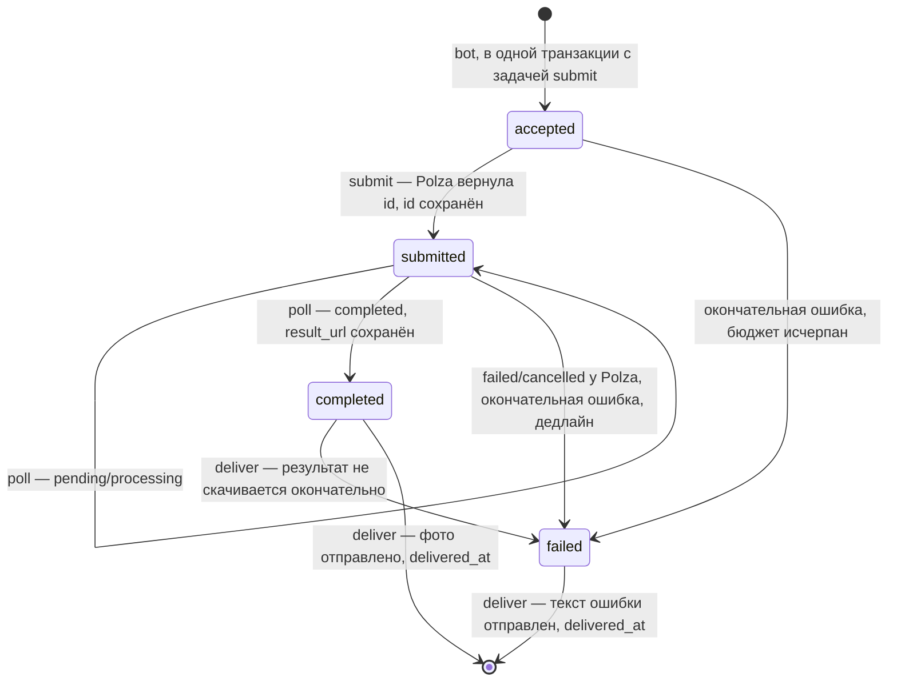
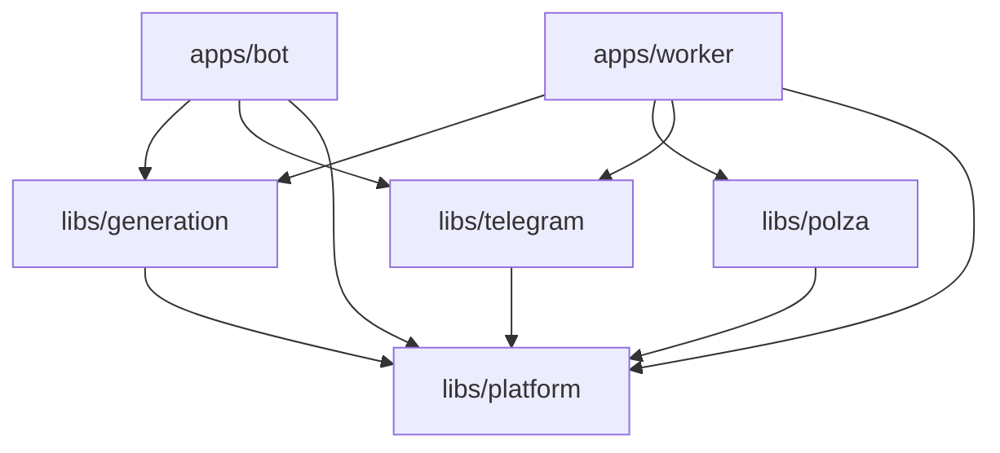
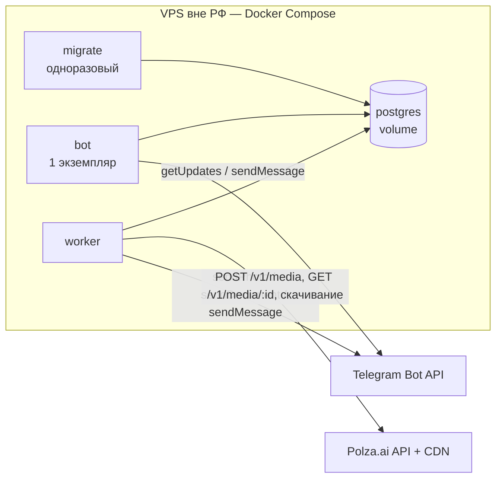
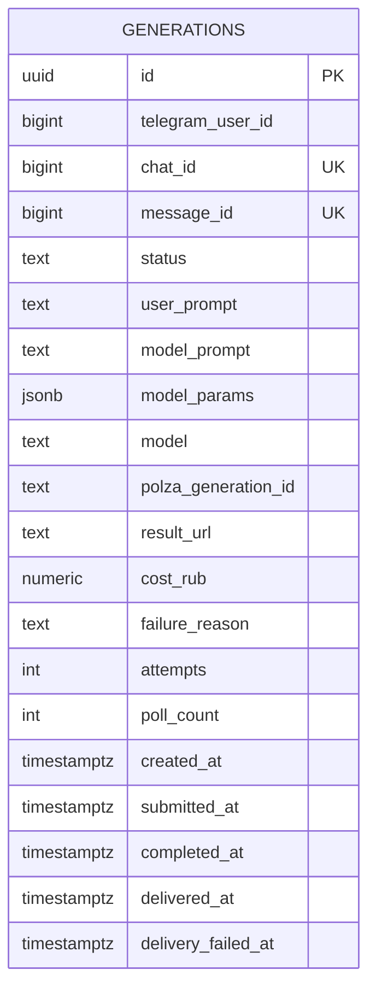

# Architecture Spine — Pixora

## Design Paradigm

**Pipes-and-filters поверх надёжной очереди.** Каждая генерация — строка в `generations` с явной машиной состояний; каждый шаг конвейера — отдельная задача pg-boss, которая продвигает генерацию ровно на один переход. Упавший шаг повторяется сам, не перезапуская предыдущие.

**Модульный монолит:** одна кодовая база NestJS (монорепо), два процесса с разными ролями.

| Слой | Где живёт | Роль |
| --- | --- | --- |
| Ingress | `apps/bot` | long polling Telegram, белый список, приём запроса, ответ «принято» |
| Pipeline | `apps/worker` | обработчики `generation.submit`, `generation.poll`, `generation.deliver`, `generation.dead` |
| Domain | `libs/generation` | машина состояний, `advance()`, бюджет повторов, причины отказа, словарь сообщений |
| Adapters | `libs/polza`, `libs/telegram` | HTTP-клиенты и классификаторы ошибок Polza и Telegram |
| Platform | `libs/platform` | конфиг, БД (Drizzle), pg-boss и его очереди, логгер |



## Invariants & Rules



### AD-1 — Postgres — единственный источник истины, очередь в нём же [ADOPTED]

- **Binds:** all
- **Prevents:** расхождение состояния генерации между БД и брокером; потеря принятого запроса при падении между записью и постановкой задачи.
- **Rule:** Состояние генераций хранится только в PostgreSQL; очередь — pg-boss в той же базе. Redis и другие брокеры не используются. Очереди и их опции создаёт только `libs/platform` при старте worker; все `generation.*` очереди — политика `stately`, каждая задача отправляется с `singletonKey = generationId`.

### AD-2 — Переходы состояния только через `advance()` доменного модуля

- **Binds:** `apps/bot`, `apps/worker`, `libs/generation`
- **Prevents:** два пути мутации одной сущности; переход без следующей задачи (застрявшая генерация); повторная задача, перезаписывающая более позднее состояние.
- **Rule:** Таблицу `generations` пишет только `libs/generation`. `apps/bot` может лишь создать генерацию в `accepted` (`createAccepted`). Все остальные изменения — через единственную функцию `advance(id, expectedStatus, patch, nextJob?)`, которая в одной транзакции выполняет `UPDATE … WHERE id = $1 AND status = $expected` и, если обновлена одна строка, ставит `nextJob`. Ноль строк — «уже выполнено»: обработчик завершается успешно, ничего не ставя.

### AD-3 — Один шаг конвейера = одна задача = один внешний побочный эффект [ADOPTED]

- **Binds:** `apps/worker`
- **Prevents:** повторную генерацию из-за сбоя доставки; дублирование побочных эффектов при повторе обработчика.
- **Rule:** Очереди: `generation.submit` (accepted → submitted), `generation.poll` (submitted → submitted | completed | failed), `generation.deliver` (из completed | failed — отправка пользователю), `generation.dead` (dead letter для всех трёх). Payload задачи — только `{ generationId }`; всё остальное читается из БД. Каждый обработчик делает не больше одного внешнего побочного эффекта; следующий шаг ставится только через `advance()`. Каждый переход в `completed` или `failed` ставит `generation.deliver`.

### AD-4 — Submit в Polza: не повторять после возможного приёма; окно риска принято [ADOPTED]

- **Binds:** `generation.submit`, `libs/polza`
- **Prevents:** двойное списание за одну генерацию.
- **Rule:** Submit вызывает Polza только если генерация в `accepted` и `polza_generation_id` пуст. Полученный `id` сохраняется сразу через `advance(accepted → submitted)`; если `advance` вернул ноль строк, осиротевший `id` логируется на уровне `error`. Submit повторяется **только** когда запрос заведомо не принят: ответ 408, 429, 5xx или отказ в соединении до отправки. Таймаут клиента или обрыв после отправки — `fail(provider_unavailable)` без повтора. Окно «Polza приняла, процесс упал до сохранения id» не закрывается — у Polza нет ключа идемпотентности.

### AD-5 — Результат Polza получаем только опросом [ADOPTED]

- **Binds:** `generation.poll`, `libs/polza`
- **Prevents:** второй путь завершения генерации (callback) и требование публичного HTTPS.
- **Rule:** Генерация создаётся через Media API `POST /v1/media`; статус читается `GET /v1/media/:id`. `pending`/`processing` — poll ставит следующий poll через `advance(submitted → submitted)` с `startAfter = POLL_INTERVAL` и инкрементом `poll_count`. `completed` — сохраняется `data.url` и `cost_rub`; если `url` нет — `fail(provider_failed)`. `failed`/`cancelled` — `fail` по коду ошибки Polza (AD-6). Если `now() - submitted_at > POLL_DEADLINE` — `fail(timeout)`. `callBackUrl` не передаётся.

### AD-6 — Классификация ошибок и бюджет повторов — в одном месте

- **Binds:** `libs/polza`, `libs/telegram`, `libs/generation`, все обработчики worker
- **Prevents:** бесконечные повторы; разные решения «повторять или нет» в разных обработчиках; ошибки собственного кода, выданные за сбой провайдера.
- **Rule:** Ответы с ошибкой проходят через классификатор адаптера (`libs/polza`, `libs/telegram`), который возвращает `retry(after?)`, `fail(reason)` или `drop` (только Telegram). Таблица для Polza (`error.code` уточняет 403):

  | Ответ Polza | Решение |
  | --- | --- |
  | 408, 500, 502, сетевая ошибка (poll, скачивание) | `retry`, пауза 1, 2, 4, 8… с, не больше 60 с |
  | 503, 429 с `Retry-After` | `retry(after = Retry-After)` |
  | 429 без `Retry-After` | `retry`, экспоненциальная пауза |
  | 402 | `fail(insufficient_funds)` |
  | 403 модерация | `fail(moderation)` |
  | 401, 403 прочие, 404 на submit | `fail(misconfigured)` |
  | 400, 413 | `fail(invalid_request)` |
  | 404 на poll, status `failed`/`cancelled` без признака модерации | `fail(provider_failed)` |

  `retry` реализуется через `advance()` на тот же статус с `startAfter` и инкрементом `generations.attempts` (сбрасывается при каждом переходе в новый статус). Бюджет исчерпан, если `attempts >= MAX_ATTEMPTS`, или `now() - created_at > GENERATION_DEADLINE`, или `after` выходит за дедлайн — тогда `fail(provider_unavailable)`. Неклассифицированное исключение бросается: pg-boss повторяет (`retryLimit` 3, `retryBackoff`), затем `generation.dead` → `fail(internal)` для submit/poll, а для deliver — запись `delivery_failed_at` и лог `delivery_lost`.

### AD-7 — Причины отказа — закрытый перечень, тексты — один словарь

- **Binds:** `libs/generation`, `generation.deliver`
- **Prevents:** «молчаливые» отказы; сырые тексты провайдера в чате; расхождение формулировок.
- **Rule:** `failure_reason` ∈ {`moderation`, `insufficient_funds`, `invalid_request`, `misconfigured`, `provider_failed`, `provider_unavailable`, `timeout`, `internal`}, ограничено CHECK в БД. Текст пользователю выбирается только по `failure_reason` из словаря в `libs/generation`; `error.message` Polza пишется в лог вместе с `trace_id`, но не отправляется пользователю.

  | Причина | Смысл текста |
  | --- | --- |
  | `moderation` | запрос отклонён модерацией, переформулируйте |
  | `invalid_request` | запрос не удалось обработать, попробуйте изменить текст |
  | `insufficient_funds`, `misconfigured`, `provider_failed`, `provider_unavailable`, `timeout`, `internal` | сервис временно недоступен, попробуйте позже |

### AD-8 — Получать обновления Telegram может только bot, в одном экземпляре

- **Binds:** `apps/bot`, `apps/worker`, `libs/telegram`, деплой
- **Prevents:** конфликт двух процессов на `getUpdates`; потеря обновления при остановке.
- **Rule:** Long polling (grammY `bot.start`) запускается только в `apps/bot`; сервис `bot` в Compose без масштабирования. `apps/worker` только отправляет через Bot API. По SIGTERM bot вызывает `bot.stop()` и выходит только после завершения промиса `bot.start()` и текущего обработчика. Webhook не используется.

### AD-9 — Приём запроса идемпотентен и проверяет доступ первым

- **Binds:** `apps/bot`
- **Prevents:** дублирование генерации при повторной доставке обновления; генерации от пользователей вне белого списка.
- **Rule:** Первым шагом проверяется Telegram user id по `ALLOWED_TELEGRAM_USER_IDS` (список id в env, изменение — рестартом); не из списка — короткий отказ, в БД ничего не пишется. `createAccepted` делает `INSERT … ON CONFLICT (chat_id, message_id) DO NOTHING RETURNING id` и ставит `generation.submit` в той же транзакции только если строка вставлена. «Принято» отправляется только после коммита и только для новой строки.

### AD-10 — Промт пользователя, промт и параметры для модели хранятся раздельно

- **Binds:** `libs/generation`, конвейер
- **Prevents:** переделку схемы и конвейера при добавлении шаблонов; второй внешний вызов внутри submit.
- **Rule:** `user_prompt` — текст пользователя как есть; `model_prompt` и `model_params` (jsonb: размер и т. п.) — то, что уходит в Polza; `model` — из `POLZA_MODEL`. В MVP всё заполняется при создании: `model_prompt = user_prompt`, `model_params` — из конфига. Submit только читает эти поля. Будущее обогащение промта — отдельный шаг конвейера перед submit, не код внутри submit.

### AD-11 — Доставка: загрузка файла, классификация ошибок Telegram

- **Binds:** `generation.deliver`, `libs/telegram`
- **Prevents:** зависимость от того, скачает ли Telegram файл с CDN Polza; молчание при сбое доставки; повторная отправка.
- **Rule:** deliver ничего не делает при заполненном `delivered_at`. Для `completed` скачивает `result_url` и отправляет `sendPhoto` multipart; при файле больше 10 MB или стороне больше лимита фото — `sendDocument`. Окончательный сбой скачивания — `advance(completed → failed, provider_failed)`, который снова ставит deliver. Ошибки Telegram: 429 — `retry(after = retry_after)`, 5xx/сеть — `retry`, 403/400 «чат недоступен» — `drop`: записать `delivery_failed_at`, залогировать. Успех — `delivered_at`. Возможный дубль сообщения при падении между отправкой и записью допустим.

## Consistency Conventions

| Concern | Convention |
| --- | --- |
| Naming | Очереди `generation.<step>`; таблицы и колонки `snake_case`; TS — `camelCase`/`PascalCase`; файлы `kebab-case` |
| Модули | ESM, как в NestJS 12 starter |
| Идентификаторы | `generations.id` — UUID v7 (`uuidv7()` Postgres); Telegram id — `bigint` |
| Время | `timestamptz` в UTC |
| Конфиг | Только env, валидация схемой при старте; невалидный конфиг — процесс не стартует. Секреты `TELEGRAM_BOT_TOKEN`, `POLZA_API_KEY`, `DATABASE_URL` — в `.env` на VPS, не в репозитории |
| Таймауты клиентов | Polza submit 60 с, poll 30 с, скачивание 60 с, Telegram 60 с; `expireInSeconds` задач 300 с — больше любого таймаута |
| Логи | JSON через pino; каждая строка конвейера содержит `generationId`, `queue`, `attempts`; ошибки Polza — с `trace_id`; токены и ключи не логируются |
| Сообщения бота | Ответ на запрос — reply на исходное сообщение; `/start` — приветствие с инструкцией; не-текст — подсказка «пришлите текстовое описание» |
| Миграции | drizzle-kit, одноразовый сервис `migrate` до старта bot и worker; схему pg-boss создаёт сам pg-boss |
| Завершение | worker: `boss.stop({ graceful: true })` с таймаутом меньше `stop_grace_period`; bot — по AD-8 |
| Тесты | Обработчики конвейера — против реального Postgres (контейнер) и фейковых клиентов за интерфейсами `libs/polza`, `libs/telegram` |

## Stack

| Name | Version |
| --- | --- |
| Node.js | 26 LTS (26.13.x) |
| TypeScript | 6.0 (strict; NestJS CLI 12 не поддерживает 7.x) |
| NestJS | 12.5 |
| grammY | 1.46 |
| PostgreSQL | 18.7 |
| pg-boss | 12.38 |
| Drizzle ORM | 0.45 |
| nestjs-pino | 5.3 |
| Docker Compose | 5.7 |

## Structural Seed



Compose: у всех сервисов `restart: unless-stopped` (кроме `migrate`); у `postgres` healthcheck; `bot` и `worker` — `depends_on` с `postgres: service_healthy` и `migrate: service_completed_successfully`; `stop_grace_period: 90s`; логи — драйвер `json-file` с ротацией. Окружения: `local` (тот же compose) и `prod` (VPS).



`UNIQUE (chat_id, message_id)`; `status` ∈ {`accepted`, `submitted`, `completed`, `failed`} и `failure_reason` (AD-7) — CHECK-ограничения.

```text
pixora/
  apps/
    bot/          # grammY long polling, белый список, приём
    worker/       # обработчики generation.submit|poll|deliver|dead
  libs/
    generation/   # машина состояний, advance(), бюджет повторов, словарь сообщений
    polza/        # клиент Media API, классификатор ошибок
    telegram/     # отправка, классификатор ошибок Telegram (без polling)
    platform/     # config, drizzle, pg-boss и очереди, logger
  drizzle/        # миграции
  docker-compose.yml
```

## Capability → Architecture Map

| Capability / Area | Lives in | Governed by |
| --- | --- | --- |
| Свободный текстовый запрос → одно изображение | `apps/bot` → `apps/worker` | AD-3, AD-5, AD-11 |
| Белый список | `apps/bot` | AD-9 |
| Приём не зависит от длительности генерации | `apps/bot`, pg-boss | AD-1, AD-3 |
| Рестарт не теряет принятые запросы | PostgreSQL, pg-boss | AD-1, AD-2, AD-8, AD-9 |
| Повторы временных ошибок Polza | `libs/polza`, `libs/generation` | AD-4, AD-6 |
| Понятное сообщение при окончательной ошибке | `libs/generation`, `generation.deliver` | AD-6, AD-7, AD-11 |
| Фиксированная модель | `libs/platform` config | AD-10 |
| Шаблоны в следующей версии без переделки | `libs/generation`, новый шаг конвейера | AD-10 |
| Развёртывание и работа всех сервисов | Docker Compose на VPS | AD-8, Structural Seed |

## Open Questions

- **Как Polza сообщает о модерации в результате опроса** (`failed` с каким `error.code`) и какие коды 403 означают модерацию — уточнить на реальном API до реализации классификатора (AD-6).
- **Доступность Polza API и CDN с VPS вне РФ** — проверить с выбранного VPS до деплоя.

## Deferred

- **Выбор конкретной модели Polza** — значение `POLZA_MODEL` и `model_params`; решается экспериментом, архитектуру не меняет.
- **Оповещение автора о `insufficient_funds`/`misconfigured`** — не делаем; такие отказы пишутся в лог уровня `error`, баланс автор проверяет в консоли Polza.
- **Дневной лимит на пользователя** — проверка в `apps/bot` до `createAccepted`, подсчётом по `generations` (`cost_rub` уже хранится).
- **Метрики, дашборды, трейсинг** — JSON-логи с `generationId` достаточны на одном VPS.
- **Сверка двойных списаний через History API Polza** — риск принят (AD-4); пересмотреть, если дубли появятся в расходах.
- **Callback Polza и webhook Telegram** — только при горизонтальном масштабировании.
- **Конкретный VPS-провайдер, CI/CD, бэкапы БД** — деплой вручную `docker compose up`; данные не критичны.
- **Собственное хранилище изображений** — Polza держит результат 7 дней, доставка занимает минуты.
- **Шаблоны и обогащение промта LLM** — следующая версия, отдельный шаг конвейера перед submit (AD-10).
