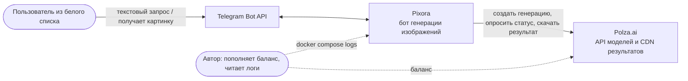
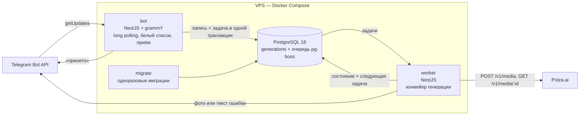
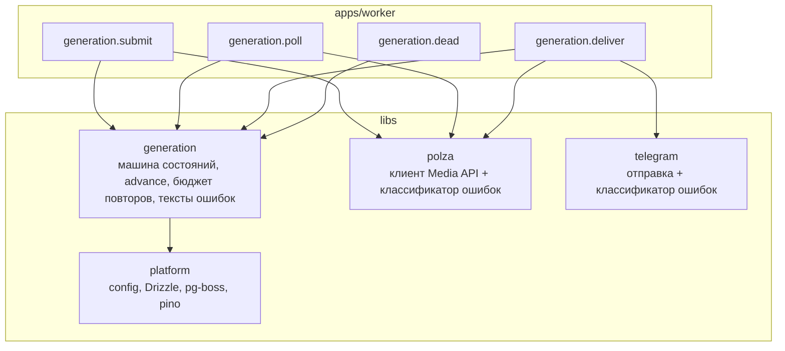
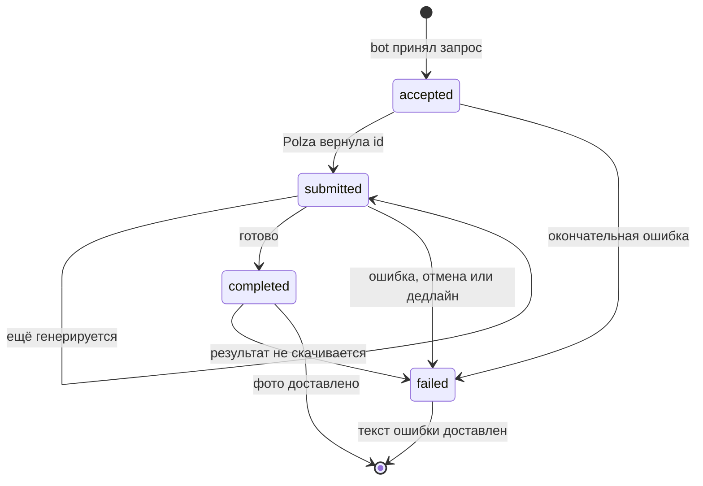
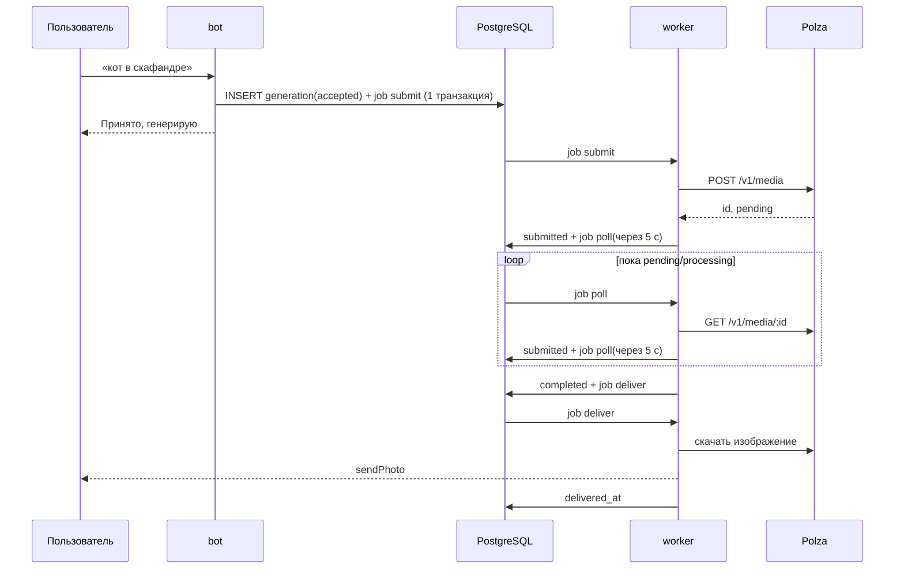

# Pixora: архитектура Telegram-бота генерации изображений

Pixora — Telegram-бот, который по текстовому описанию генерирует изображение через агрегатор моделей [Polza.ai](https://polza.ai). Им пользуется закрытый круг людей. Ценность проекта не в функциях, а в бэкенде: генерация идёт долго, стоит денег и иногда падает на стороне провайдера, поэтому система должна принимать запросы мгновенно, переживать перезапуски и не тратить деньги впустую.

Этот документ объясняет, как устроена система и почему она устроена именно так.

## Требования к надёжности

1. Приём сообщения не зависит от того, сколько длится генерация.
2. Перезапуск любого процесса не теряет принятые запросы.
3. Временные ошибки провайдера (таймауты, лимиты, недоступность) обрабатываются повторами без участия пользователя.
4. Окончательные ошибки (модерация, закончились деньги) доходят до пользователя понятным сообщением, а не молчанием.

Два свойства Polza определяют решения сильнее всего:

- **Генерация асинхронная.** `POST /v1/media` сразу возвращает идентификатор со статусом `pending`, результат нужно забирать отдельно.
- **Ключа идемпотентности нет.** Каждая повторная отправка — новая платная генерация.

## Контекст системы (C4, уровень 1)

## Контейнеры (C4, уровень 2)

Модульный монолит: одна кодовая база на NestJS, два процесса с разными ролями и PostgreSQL, в котором живут и данные, и очередь задач. Всё работает на одном VPS за пределами РФ в Docker Compose.

| Контейнер | Ответственность |
| --- | --- |
| `bot` | Единственный, кто получает обновления Telegram. Проверяет белый список, создаёт генерацию и сразу отвечает «принято» |
| `worker` | Выполняет шаги конвейера: отправка в Polza, опрос статуса, доставка результата |
| `postgres` | Единственный источник истины: таблица `generations` и очередь pg-boss |
| `migrate` | Применяет миграции схемы до старта остальных сервисов |

## Компоненты worker (C4, уровень 3)

Обработчики не знают друг о друге: они общаются только через состояние генерации в БД и очередь.

## Жизненный цикл генерации

Успешный сценарий целиком:

## Ключевые решения и компромиссы

### 1. Очередь в PostgreSQL, а не в Redis или брокере

**Решение.** Очередь задач — pg-boss в той же базе, где хранятся генерации. Запись генерации и постановка первой задачи происходят в одной транзакции.

**Альтернативы.** BullMQ + Redis — стандарт в мире Node.js. RabbitMQ или NATS JetStream — полноценные брокеры.

**Почему так.** Если состояние живёт в двух хранилищах, появляется проблема двойной записи: запрос записан в БД, а задача в Redis не попала, или наоборот. Её решают паттерном transactional outbox, то есть ещё одним механизмом. Очередь в Postgres снимает проблему целиком: принятый запрос либо есть вместе со своей задачей, либо его нет совсем.

**Цена.** Пропускная способность ниже, чем у Redis. Для круга друзей это не важно, а меньше движущихся частей — меньше способов сломаться.

### 2. Модульный монолит с двумя процессами, а не микросервисы

**Решение.** Одна кодовая база, процессы `bot` и `worker`, общие библиотеки с жёстким направлением зависимостей.

**Почему так.** Разделение процессов уже даёт главное: приём не зависит от генерации, и их можно перезапускать независимо. Микросервисы добавили бы сетевые контракты и версионирование без выигрыша на таком масштабе.

### 3. Один шаг — одна задача — один переход состояния

**Решение.** Конвейер разбит на задачи `submit`, `poll`, `deliver`. Каждая выполняет не больше одного внешнего вызова и продвигает генерацию на один переход. Переход делается условным `UPDATE … WHERE status = ожидаемый`, и в той же транзакции ставится следующая задача.

**Почему так.** Если Telegram не принял фото, повторяется только доставка, а не платная генерация. Повторная или запоздавшая задача видит, что переход уже выполнен, и ничего не делает. В каждой очереди у генерации не больше одной задачи в ожидании и одной в работе (`singletonKey = generationId`), поэтому цепочки опроса не размножаются.

### 4. Риск двойного списания принят осознанно

**Проблема.** У Polza нет ключа идемпотентности. Если worker упадёт после того, как Polza приняла запрос, но до того, как её `id` сохранён, повтор оплатит генерацию второй раз.

**Что сделано.**
- Отправка не выполняется, если `id` уже сохранён.
- Отправка повторяется, только когда Polza заведомо не приняла запрос (ответ 408, 429, 5xx или отказ в соединении). Таймаут или обрыв после отправки завершают генерацию ошибкой без повтора.
- Время жизни задачи в pg-boss больше любого HTTP-таймаута, чтобы задачу не подхватил второй обработчик, пока первый ещё работает.

**Что осталось.** Окно в миллисекунды между ответом Polza и коммитом. Закрыть его можно сверкой с историей генераций Polza, но это отдельный механизм ради редкого и дешёвого случая. Решение пересматривается, если дубли появятся в расходах.

### 5. Опрос статуса, а не callback

**Решение.** Worker опрашивает `GET /v1/media/:id` каждые 5 секунд через отложенные задачи, не дольше 10 минут.

**Почему так.** Callback требует публичного HTTPS-эндпоинта и создаёт второй путь завершения генерации, который пришлось бы согласовывать с первым. Опрос проще, и на нашей нагрузке его стоимость незаметна.

### 6. Конечный бюджет повторов

**Проблема.** Повтор через новую отложенную задачу сбрасывает счётчик попыток pg-boss, поэтому наивная реализация повторяет бесконечно.

**Решение.** Счётчик попыток хранится в самой генерации и сбрасывается при каждом переходе. Генерация завершается ошибкой, если попыток на шаге стало 5 или с момента приёма прошло больше 30 минут. Если Polza просит подождать дольше дедлайна (например, дневной лимит до полуночи), генерация завершается сразу. Ошибки собственного кода идут отдельным путём: встроенные повторы pg-boss, затем dead letter очередь, затем понятное сообщение пользователю.

### 7. Одна таблица классификации ошибок

**Решение.** Все ответы Polza и Telegram проходят через классификатор адаптера, который возвращает одно из трёх решений: «повторить», «завершить с причиной» или «отказаться от доставки». Причины отказа — закрытый перечень с CHECK-ограничением в БД. Текст пользователю выбирается только по причине; сырые сообщения провайдера идут в лог.

**Почему так.** Решение «повторять или нет» принимается в одном месте, а пользователь никогда не видит технический текст ошибки.

### 8. Long polling Telegram, один экземпляр бота

**Решение.** Обновления получает только процесс `bot` в одном экземпляре, без webhook.

**Почему так.** Не нужны домен, TLS и reverse proxy. Telegram хранит неподтверждённые обновления сутки, а grammY подтверждает их после обработки. Повторно доставленное обновление отсекается уникальным ключом `(chat_id, message_id)`.

### 9. Структурированные логи вместо метрик и трейсинга

**Решение.** JSON-логи pino, в каждой строке конвейера есть `generationId`, имя очереди и номер попытки.

**Почему так.** На одном VPS с двумя процессами историю любой генерации можно восстановить фильтром по `generationId`. Prometheus, Grafana и трейсинг заняли бы заметную часть памяти сервера без ощутимой пользы.

## Что происходит при сбоях

| Сбой | Поведение системы |
| --- | --- |
| Перезапуск `bot` во время приёма | Транзакция либо закоммичена (задача в очереди), либо нет (Telegram передоставит обновление). Дубль отсекается уникальным ключом |
| Перезапуск `worker` | Незавершённые задачи возвращаются в очередь, повторная задача видит актуальный статус и продолжает с нужного шага |
| Перезапуск `postgres` | Процессы ждут healthcheck и переподключаются; данные на volume |
| Polza 429 / 503 | Повтор не раньше `Retry-After`, иначе экспоненциальная пауза |
| Polza 402 (нет денег) | Пользователь получает «сервис временно недоступен», в логе ошибка уровня `error` |
| Polza 403 (модерация) | Пользователь получает «запрос отклонён модерацией» |
| Генерация зависла у провайдера | Через 10 минут опроса генерация завершается с сообщением пользователю |
| Telegram не принял фото | Повторяется только доставка; генерация не перезапускается |
| Ошибка в нашем коде | Повторы pg-boss, затем dead letter очередь, затем сообщение пользователю |

## Что осознанно не сделано

- Метрики, дашборды и распределённый трейсинг.
- Callback от Polza и webhook Telegram.
- Сверка двойных списаний через историю Polza.
- Оповещение автора о нулевом балансе.
- Дневной лимит на пользователя (стоимость каждой генерации уже хранится, лимит добавляется проверкой при приёме).
- CI/CD и бэкапы: деплой вручную, данные не критичны.

Шаблоны генерации из следующей версии встраиваются без переделки: текст пользователя, промт для модели и параметры модели хранятся раздельно, а обогащение промта станет отдельным шагом конвейера перед отправкой.

## Стек

| Слой | Технология |
| --- | --- |
| Рантайм | Node.js 26 LTS, TypeScript 6 (ESM) |
| Фреймворк | NestJS 12, монорепо |
| Telegram | grammY 1.46 |
| База и очередь | PostgreSQL 18, pg-boss 12 |
| Доступ к БД | Drizzle ORM |
| Логи | pino (nestjs-pino) |
| Развёртывание | Docker Compose на VPS |
